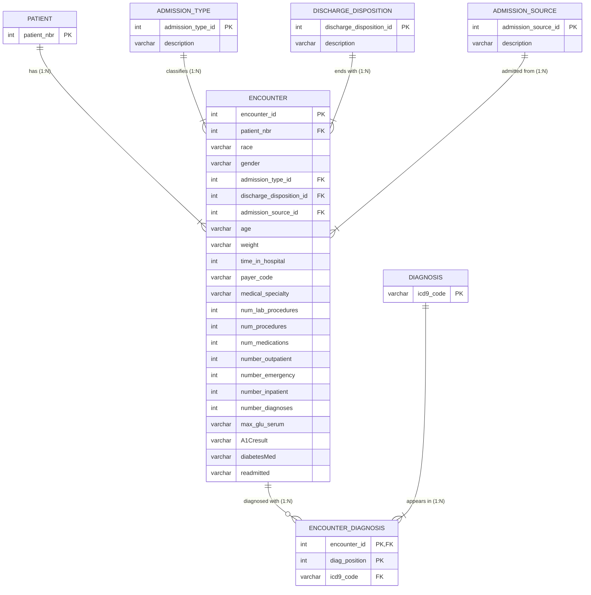

# CSCI 49376 Assignment 1 Report

Mia Yábar  · Jas 
Big Data Technology · Prof. Alex Liew 

## Part 1. Select and Examine the Original Dataset

1. Dataset selected: Diabetes 130-US Hospitals for Years 1999-2008 (Kaggle: brandao/diabetes)
2. CSV file used: `diabetic_data.csv`
3. Total rows: 101,766
4. Total columns: 50 (24 ignored, 26 used)
5. Attributes:
	1. encounter_id
	2. patient_nbr
	3. race
	4. gender
	5. age
	6. weight
	7. admission_type_id
	8. discharge_disposition_id
	9. admission_source_id
	10. time_in_hospital
	11. payer_code
	12. medical_specialty
	13. num_lab_procedures
	14. num_procedures
	15. num_medications
	16. number_outpatient
	17. number_emergency
	18. number_inpatient
	19. diag_1
	20. diag_2
	21. diag_3
	22. number_diagnoses
	23. max_glu_serum
	24. A1Cresult
	25. diabetesMed
	26. readmitted

Ignored (24): metformin, repaglinide, nateglinide, chlorpropamide, glimepiride, acetohexamide, glipizide, glyburide, tolbutamide, pioglitazone, rosiglitazone, acarbose, miglitol, troglitazone, tolazamide, examide, citoglipton, insulin, glyburide-metformin, glipizide-metformin, glimepiride-pioglitazone, metformin-rosiglitazone, metformin-pioglitazone, change.

6. Brief description of what each attribute represents:
	1. encounter_id: Unique ID of one hospital stay
	2. patient_nbr: ID of a patient (a patient can have several stays)
	3. race: Caucasian, AfricanAmerican, Hispanic, Asian, Other
	4. gender: Female, Male, Unknown/Invalid
	5. age: Age group
	6. weight: Weight band in pounds
	7. admission_type_id: Code for the type of admission (e.g. emergency, elective)
	8. discharge_disposition_id: Code for where the patient went at discharge (e.g. home)
	9. admission_source_id: Code for where the patient came from (e.g. referral, ER)
	10. time_in_hospital: Days in the hospital (1–14)
	11. payer_code: Insurance code 
	12. medical_specialty: Specialty of the admitting doctor
	13. num_lab_procedures: Lab tests during the stay
	14. num_procedures: Other procedures during the stay
	15. num_medications: Distinct medications given
	16. number_outpatient: Outpatient visits in the prior year
	17. number_emergency: Emergency visits in the prior year
	18. number_inpatient: Inpatient visits in the prior year
	19. diag_1: Primary diagnosis (ICD-9 code)
	20. diag_2: Secondary diagnosis (ICD-9 code)
	21. diag_3: Additional diagnosis (ICD-9 code)
	22. number_diagnoses: Number of diagnoses recorded
	23. max_glu_serum: Glucose test: >200, >300, Norm, None (not measured)
	24. A1Cresult: HbA1c test: >7, >8, Norm, None (not measured)
	25. diabetesMed: Any diabetes medication prescribed: Yes/No
	26. readmitted: NO, >30 (after 30 days), <30 (within 30 days)
7. Possible identifiers or keys:
	1. encounter_id: key of a stay. One value per row (101,766).
	2. patient_nbr: ID of a patient (71,518 patients). A patient can have several stays.
	3. admission_type_id, discharge_disposition_id, admission_source_id: codes (8, 26, and 17 values).
	4. diag_1, diag_2, diag_3: diagnosis codes. Many stays share a code.
8. Missing, unknown or incomplete values:
	1. weight (`?`, 96.9%)
	2. max_glu_serum: None (not measured, 94.7%)
	3. A1Cresult: None (not measured, 83.3%)
	4. medical_specialty (`?`, 49.1%)
	5. payer_code (`?`, 39.6%)
	6. race (`?`, 2,273 rows, 2.2%)
	7. gender: Unknown/Invalid (3)
	8. diag_1 (`?`, 21), diag_2 (`?`, 358), diag_3 (`?`, 1,423)

All of these are stored as NULL in the database.
	

Inconsistencies: 123 patients have two different race values and 3 have two genders across stays 

## Part 2. Normalize the Dataset

**In short:** 1NF puts each diagnosis on its own row. 2NF moves the stay columns to ENCOUNTER, so each stay is stored once.

Example used throughout: stay 149190 (patient 55629189).
**Stay columns** = the columns that describe one hospital visit: race, gender, age, weight, admission_type_id, discharge_disposition_id, admission_source_id, time_in_hospital, payer_code, medical_specialty, num_lab_procedures, num_procedures, num_medications, number_outpatient, number_emergency, number_inpatient, number_diagnoses, max_glu_serum, A1Cresult, diabetesMed, readmitted. Race and gender are stay columns. They can differ across a patient's stays.

### Original relation

1. Structure: DIABETIC_DATA, one table, one row per stay (101,766 rows). diag_1, diag_2 and diag_3 are on that row.
2. Key: encounter_id.
3. Functional dependencies: encounter_id → every other column.
4. Problem: diag_1, diag_2 and diag_3 are a repeating group. Three columns, same kind of value.
5. Change: one row per diagnosis. Add diag_position, 1, 2 or 3.
6. Form: not 1NF, because of the repeating group.

| encounter_id | patient_nbr | race | gender | age | time_in_hospital | diag_1 | diag_2 | diag_3 | readmitted |
|---|---|---|---|---|---|---|---|---|---|
| 149190 | 55629189 | Caucasian | Female | [10-20) | 3 | 276 | 250.01 | 255 | >30 |

### 1NF relation

1. Structure: one row per diagnosis. diag_1, diag_2 and diag_3 become icd9_code, plus diag_position. Stay columns still repeat on each row.
2. Key: (encounter_id, diag_position). 5,492 stays list the same code twice, so icd9_code is not in the key.
3. Functional dependencies: (encounter_id, diag_position) → icd9_code. encounter_id → the stay columns.
4. Problem: partial dependency. Stay columns depend on encounter_id only, so they repeat on every diagnosis row.
5. Change: move the stay columns to ENCOUNTER. Diagnoses stay in ENCOUNTER_DIAGNOSIS.
6. Form: 1NF. Every cell holds one value.

| encounter_id | diag_position | icd9_code | patient_nbr | race      | time_in_hospital | readmitted |
| ------------ | ------------- | --------- | ----------- | --------- | ---------------- | ---------- |
| 149190       | 1             | 276       | 55629189    | Caucasian | 3                | >30        |
| 149190       | 2             | 250.01    | 55629189    | Caucasian | 3                | >30        |
| 149190       | 3             | 255       | 55629189    | Caucasian | 3                | >30        |

### 2NF relations

1. Structure: ENCOUNTER(encounter_id, patient_nbr, stay columns) and ENCOUNTER_DIAGNOSIS(encounter_id, diag_position, icd9_code).
2. Keys: ENCOUNTER: encounter_id. ENCOUNTER_DIAGNOSIS: (encounter_id, diag_position). encounter_id points to ENCOUNTER.
3. Functional dependencies: encounter_id → the stay columns, in ENCOUNTER. (encounter_id, diag_position) → icd9_code, in ENCOUNTER_DIAGNOSIS.
4. Problem: none.
5. Change: none.
6. Form: 2NF. Every non-key column depends on the whole key.

ENCOUNTER

| encounter_id | patient_nbr | race | gender | admission_type_id | age | time_in_hospital | readmitted |
|---|---|---|---|---|---|---|---|
| 149190 | 55629189 | Caucasian | Female | 1 | [10-20) | 3 | >30 |

ENCOUNTER_DIAGNOSIS

| encounter_id | diag_position | icd9_code |
|---|---|---|
| 149190 | 1 | 276 |
| 149190 | 2 | 250.01 |
| 149190 | 3 | 255 |

### Final tables

ENCOUNTER and ENCOUNTER_DIAGNOSIS are the 2NF tables. PATIENT is the patient id. DIAGNOSIS stores each code once. The three code tables store each id and its description.

| Table | Attributes | Primary key | Foreign key(s) |
|---|---|---|---|
| PATIENT | patient_nbr | patient_nbr | — |
| ENCOUNTER | encounter_id, patient_nbr, race, gender, admission_type_id, discharge_disposition_id, admission_source_id, age, weight, time_in_hospital, payer_code, medical_specialty, num_lab_procedures, num_procedures, num_medications, number_outpatient, number_emergency, number_inpatient, number_diagnoses, max_glu_serum, A1Cresult, diabetesMed, readmitted | encounter_id | patient_nbr, admission_type_id, discharge_disposition_id, admission_source_id |
| ENCOUNTER_DIAGNOSIS | encounter_id, diag_position, icd9_code | (encounter_id, diag_position) | encounter_id, icd9_code |
| DIAGNOSIS | icd9_code | icd9_code | — |
| ADMISSION_TYPE | admission_type_id, description | admission_type_id | — |
| DISCHARGE_DISPOSITION | discharge_disposition_id, description | discharge_disposition_id | — |
| ADMISSION_SOURCE | admission_source_id, description | admission_source_id | — |

## Part 3. Construct an ER Diagram

| Relationship   | Between                           | Type | Why                                                                                                                                                           | Participation                                                             |
| -------------- | --------------------------------- | ---- | ------------------------------------------------------------------------------------------------------------------------------------------------------------- | ------------------------------------------------------------------------- |
| has            | PATIENT – ENCOUNTER               | 1:N  | A patient has many stays; a stay has one patient.                                                                                                             | Total on both sides                                                       |
| classifies     | ADMISSION_TYPE – ENCOUNTER        | 1:N  | A type covers many stays; a stay has one type.                                                                                                                | Total on both sides                                                        |
| ends with      | DISCHARGE_DISPOSITION – ENCOUNTER | 1:N  | A disposition covers many stays; a stay has one disposition.                                                                                                  | Total on both sides                                                        |
| admitted from  | ADMISSION_SOURCE – ENCOUNTER      | 1:N  | A source covers many stays; a stay has one source.                                                                                                            | Total on both sides                                                        |
| diagnosed with | ENCOUNTER – DIAGNOSIS             | M:N  | A stay has up to 3 diagnoses; a diagnosis appears in many stays. Drawn as two 1:N relationships through ENCOUNTER_DIAGNOSIS, which also stores diag_position. | Partial for ENCOUNTER (some stays have no diagnosis), total for DIAGNOSIS |

## Part 4. Convert the ER Diagram into Relational Tables

| Relation | Attributes | Primary key | Foreign key(s) |
|---|---|---|---|
| PATIENT | patient_nbr | patient_nbr | — |
| ADMISSION_TYPE | admission_type_id, description | admission_type_id | — |
| DISCHARGE_DISPOSITION | discharge_disposition_id, description | discharge_disposition_id | — |
| ADMISSION_SOURCE | admission_source_id, description | admission_source_id | — |
| DIAGNOSIS | icd9_code | icd9_code | — |
| ENCOUNTER | encounter_id, patient_nbr, race, gender, admission_type_id, discharge_disposition_id, admission_source_id, age, weight, time_in_hospital, payer_code, medical_specialty, num_lab_procedures, num_procedures, num_medications, number_outpatient, number_emergency, number_inpatient, number_diagnoses, max_glu_serum, A1Cresult, diabetesMed, readmitted | encounter_id | patient_nbr, admission_type_id, discharge_disposition_id, admission_source_id |
| ENCOUNTER_DIAGNOSIS | encounter_id, diag_position, icd9_code | (encounter_id, diag_position) | encounter_id, icd9_code |

### How the ER relationships are represented

| ER relationship | Type | Represented as |
|---|---|---|
| PATIENT has ENCOUNTER | 1:N | Foreign key ENCOUNTER.patient_nbr → PATIENT (on the N side, NOT NULL) |
| ADMISSION_TYPE classifies ENCOUNTER | 1:N | Foreign key ENCOUNTER.admission_type_id → ADMISSION_TYPE (on the N side, NOT NULL) |
| DISCHARGE_DISPOSITION ends with ENCOUNTER | 1:N | Foreign key ENCOUNTER.discharge_disposition_id → DISCHARGE_DISPOSITION (on the N side, NOT NULL) |
| ADMISSION_SOURCE admitted from ENCOUNTER | 1:N | Foreign key ENCOUNTER.admission_source_id → ADMISSION_SOURCE (on the N side, NOT NULL) |
| ENCOUNTER diagnosed with DIAGNOSIS | M:N | Its own table, ENCOUNTER_DIAGNOSIS: a foreign key to each side plus diag_position |

Table creation order: PATIENT, ADMISSION_TYPE, DISCHARGE_DISPOSITION, ADMISSION_SOURCE, DIAGNOSIS → ENCOUNTER → ENCOUNTER_DIAGNOSIS.

## Part 5. Implement the Database Using SQL 

We wrote a script with necessary CREATE TABLE statements for all tables in our database design. We labeled primary/foreign key constraints appropriately, as well as specified when entries could not be NULL. The database design was formed directly based off of the ER diagram developed.

## Part 6. Import the CSV Data

We created a staging table to temporarily hold all data from the CSV file. (If running this file again, the path to the CSV must be changed). We ignored the medication columns specified to be ignored. Once we had all data, we reformatted it using the normalization rules we had already created, re-cast some entries as to not have inconsistencies with data types, and then inserted the data from the staging table into the normalized tables. All PK/FK relationships were maintained. This was done using import_data.sql. 

## Part 7. Verify the Database Using SQL

We verified that patient, encounter, diagnosis, admission type, admission source, and discharge disposition all had the expected rows. We ensured primary keys do not repeat, and there are no orphan foreign keys. We made sure there were no missing primary keys. We also picked a record at random to generate and look at, and ensured it has the proper normalized form data.
