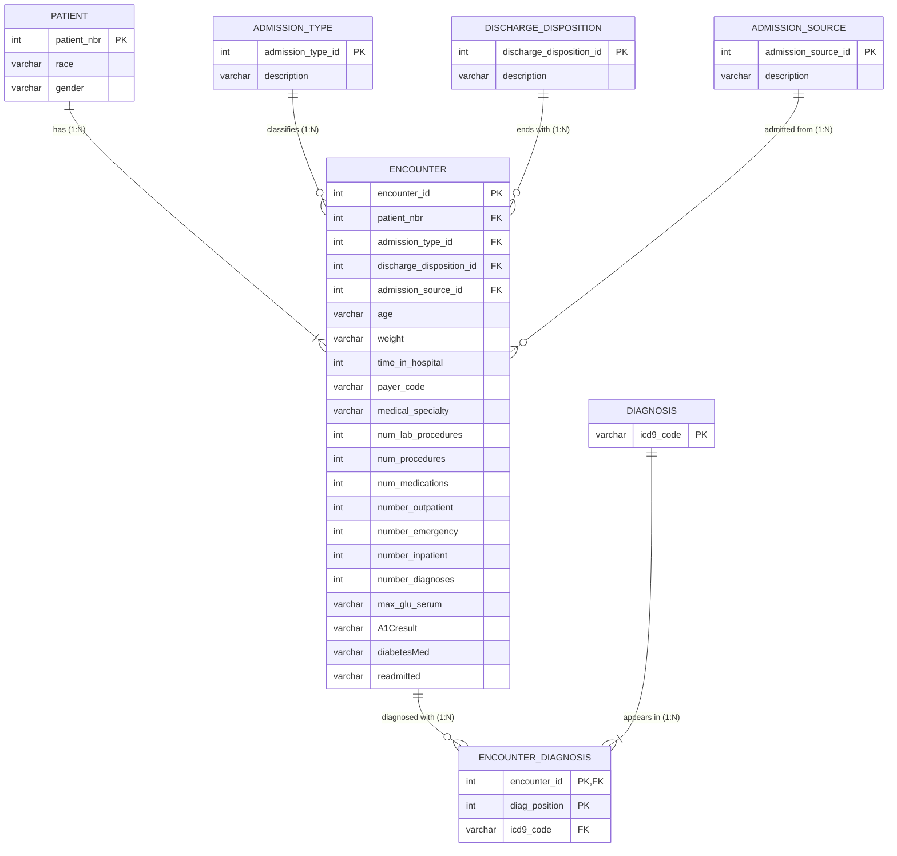

# CSCI 49376 Assignment 1 Report

Mia Yábar  · Jas 
Big Data Technology · Prof. Alex Liew 

## Part 1. Select and Examine the Original Dataset

1. Dataset selected: Diabetes 130-US Hospitals for Years 1999-2008 (Kaggle: brandao/diabetes)
2. CSV file used: `diabetic_data.csv`
3. Total rows: 101,766
4. Total columns: 50 (24 ignored, 26 used)
5. Attributes:
	1. encounter_id
	2. patient_nbr
	3. race
	4. gender
	5. age
	6. weight
	7. admission_type_id
	8. discharge_disposition_id
	9. admission_source_id
	10. time_in_hospital
	11. payer_code
	12. medical_specialty
	13. num_lab_procedures
	14. num_procedures
	15. num_medications
	16. number_outpatient
	17. number_emergency
	18. number_inpatient
	19. diag_1
	20. diag_2
	21. diag_3
	22. number_diagnoses
	23. max_glu_serum
	24. A1Cresult
	25. diabetesMed
	26. readmitted
6. Brief description of what each attribute represents:
	1. encounter_id: Unique ID of one hospital stay
	2. patient_nbr: ID of a patient (a patient can have several stays)
	3. race: Caucasian, AfricanAmerican, Hispanic, Asian, Other
	4. gender: Female, Male, Unknown/Invalid
	5. age: Age group
	6. weight: Weight band in pounds
	7. admission_type_id: Code for the type of admission (e.g. emergency, elective)
	8. discharge_disposition_id: Code for where the patient went at discharge (e.g. home)
	9. admission_source_id: Code for where the patient came from (e.g. referral, ER)
	10. time_in_hospital: Days in the hospital (1–14)
	11. payer_code: Insurance code 
	12. medical_specialty: Specialty of the admitting doctor
	13. num_lab_procedures: Lab tests during the stay
	14. num_procedures: Other procedures during the stay
	15. num_medications: Distinct medications given
	16. number_outpatient: Outpatient visits in the prior year
	17. number_emergency: Emergency visits in the prior year
	18. number_inpatient: Inpatient visits in the prior year
	19. diag_1: Primary diagnosis (ICD-9 code)
	20. diag_2: Secondary diagnosis (ICD-9 code)
	21. diag_3: Additional diagnosis (ICD-9 code)
	22. number_diagnoses: Number of diagnoses recorded
	23. max_glu_serum: Glucose test: >200, >300, Norm, None (not measured)
	24. A1Cresult: HbA1c test: >7, >8, Norm, None (not measured)
	25. diabetesMed: Any diabetes medication prescribed: Yes/No
	26. readmitted: NO, >30 (after 30 days), <30 (within 30 days)
7. Possible identifiers or keys:
	1. encounter_id
	2. patient_nbr
	3. admission_type_id
	4. discharge_disposition_id
	5. admission_source_id
	6. diag_1, diag_2, diag_3
8. Missing, unknown or incomplete values:
	1. weight
	2. max_glu_serum
	3. A1Cresult
	4. medical_specialty
	5. payer_code
	

Inconsistencies: 123 patients have two different race values and 3 have two genders across stays 

## Part 2. Normalize the Dataset

**In short:** 1NF splits the diagnoses into one row per diagnosis. 2NF removes the partial dependency by moving the diagnoses into their own table, ENCOUNTER_DIAGNOSIS, so each stay keeps its stay columns once and each diagnosis gets its own row.

Example used throughout: stay 149190 (patient 55629189).
**Stay columns** = the columns that describe one hospital visit: age, weight, admission_type_id, discharge_disposition_id, admission_source_id, time_in_hospital, payer_code, medical_specialty, num_lab_procedures, num_procedures, num_medications, number_outpatient, number_emergency, number_inpatient, number_diagnoses, max_glu_serum, A1Cresult, diabetesMed, readmitted.

### Original relation

1. Structure: DIABETIC_DATA, one table with one row per stay (101,766 rows).
2. Key: encounter_id.
3. Functional dependencies: encounter_id → every other column.
4. Problem: diag_1, diag_2 and diag_3 are a repeating group: three columns holding the same kind of value.
5. Change: put each diagnosis in its own row, with a new column diag_position (1, 2 or 3).
6. Form: not 1NF.

| encounter_id | patient_nbr | race | gender | age | time_in_hospital | diag_1 | diag_2 | diag_3 | readmitted |
|---|---|---|---|---|---|---|---|---|---|
| 149190 | 55629189 | Caucasian | Female | [10-20) | 3 | 276 | 250.01 | 255 | >30 |

### 1NF relation

1. Structure: one row per diagnosis. diag_1, diag_2 and diag_3 become one column, icd9_code, plus diag_position.
2. Key: (encounter_id, diag_position).
3. Functional dependencies:
	- (encounter_id, diag_position) → icd9_code. Needs the whole key.
	- encounter_id → patient_nbr and the stay columns. Needs only part of the key.
4. Problem: **partial dependency**. The stay columns depend on encounter_id alone, so they are copied on every diagnosis row (time_in_hospital = 3 appears three times below).
5. Change: split the table into ENCOUNTER (one row per stay) and ENCOUNTER_DIAGNOSIS (one row per diagnosis).
6. Form: 1NF. Every cell holds one value.

| encounter_id | diag_position | icd9_code | patient_nbr | race      | time_in_hospital | readmitted |
| ------------ | ------------- | --------- | ----------- | --------- | ---------------- | ---------- |
| 149190       | 1             | 276       | 55629189    | Caucasian | 3                | >30        |
| 149190       | 2             | 250.01    | 55629189    | Caucasian | 3                | >30        |
| 149190       | 3             | 255       | 55629189    | Caucasian | 3                | >30        |

### 2NF relations

1. Structure: ENCOUNTER(encounter_id, patient_nbr, stay columns) and ENCOUNTER_DIAGNOSIS(encounter_id, diag_position, icd9_code).
2. Keys: ENCOUNTER: encounter_id. ENCOUNTER_DIAGNOSIS: (encounter_id, diag_position), where encounter_id is also a foreign key to ENCOUNTER.
3. Functional dependencies: encounter_id → stay columns, in ENCOUNTER. (encounter_id, diag_position) → icd9_code, in ENCOUNTER_DIAGNOSIS.
4. Problem: none. No partial dependency is left.
5. Change: none needed for 2NF.
6. Form: 2NF. Every non-key column depends on the whole key: each stay has its stay columns once, and each diagnosis has its own row.

ENCOUNTER

| encounter_id | patient_nbr | admission_type_id | age | time_in_hospital | readmitted |
|---|---|---|---|---|---|
| 149190 | 55629189 | 1 | [10-20) | 3 | >30 |

ENCOUNTER_DIAGNOSIS

| encounter_id | diag_position | icd9_code |
|---|---|---|
| 149190 | 1 | 276 |
| 149190 | 2 | 250.01 |
| 149190 | 3 | 255 |

We also gave patients and codes their own tables, so each fact is stored once: PATIENT (race and gender once per patient), DIAGNOSIS (each code once), and ADMISSION_TYPE, DISCHARGE_DISPOSITION, ADMISSION_SOURCE (each code and its description once).

PATIENT

| patient_nbr | race | gender |
|---|---|---|
| 55629189 | Caucasian | Female |

DIAGNOSIS

| icd9_code |
|---|
| 276 |
| 250.01 |
| 255 |

ADMISSION_TYPE

| admission_type_id | description |
|---|---|
| 1 | Emergency |

### Final tables

| Table | Attributes | Primary key | Foreign key(s) |
|---|---|---|---|
| PATIENT | patient_nbr, race, gender | patient_nbr | — |
| ENCOUNTER | encounter_id, patient_nbr, admission_type_id, discharge_disposition_id, admission_source_id, age, weight, time_in_hospital, payer_code, medical_specialty, num_lab_procedures, num_procedures, num_medications, number_outpatient, number_emergency, number_inpatient, number_diagnoses, max_glu_serum, A1Cresult, diabetesMed, readmitted | encounter_id | patient_nbr, admission_type_id, discharge_disposition_id, admission_source_id |
| ENCOUNTER_DIAGNOSIS | encounter_id, diag_position, icd9_code | (encounter_id, diag_position) | encounter_id, icd9_code |
| DIAGNOSIS | icd9_code | icd9_code | — |
| ADMISSION_TYPE | admission_type_id, description | admission_type_id | — |
| DISCHARGE_DISPOSITION | discharge_disposition_id, description | discharge_disposition_id | — |
| ADMISSION_SOURCE | admission_source_id, description | admission_source_id | — |


## Part 3. Construct an ER Diagram




| Relationship   | Between                           | Type | Why                                                                                                                                                           | Participation                                                             |
| -------------- | --------------------------------- | ---- | ------------------------------------------------------------------------------------------------------------------------------------------------------------- | ------------------------------------------------------------------------- |
| has            | PATIENT – ENCOUNTER               | 1:N  | A patient has many stays; a stay has one patient.                                                                                                             | Total on both sides                                                       |
| classifies     | ADMISSION_TYPE – ENCOUNTER        | 1:N  | A type covers many stays; a stay has one type.                                                                                                                | Total for ENCOUNTER, partial for the type                                 |
| ends with      | DISCHARGE_DISPOSITION – ENCOUNTER | 1:N  |                                                                                                                                                               | Total for ENCOUNTER, partial for the disposition                          |
| admitted from  | ADMISSION_SOURCE – ENCOUNTER      | 1:N  |                                                                                                                                                               | Total for ENCOUNTER, partial for the source                               |
| diagnosed with | ENCOUNTER – DIAGNOSIS             | M:N  | A stay has up to 3 diagnoses; a diagnosis appears in many stays. Drawn as two 1:N relationships through ENCOUNTER_DIAGNOSIS, which also stores diag_position. | Partial for ENCOUNTER (some stays have no diagnosis), total for DIAGNOSIS |


## Part 4. Convert the ER Diagram into Relational Tables

| Relation | Attributes | Primary key | Foreign key(s) |
|---|---|---|---|
| PATIENT | patient_nbr, race, gender | patient_nbr | — |
| ADMISSION_TYPE | admission_type_id, description | admission_type_id | — |
| DISCHARGE_DISPOSITION | discharge_disposition_id, description | discharge_disposition_id | — |
| ADMISSION_SOURCE | admission_source_id, description | admission_source_id | — |
| DIAGNOSIS | icd9_code | icd9_code | — |
| ENCOUNTER | encounter_id, patient_nbr, admission_type_id, discharge_disposition_id, admission_source_id, age, weight, time_in_hospital, payer_code, medical_specialty, num_lab_procedures, num_procedures, num_medications, number_outpatient, number_emergency, number_inpatient, number_diagnoses, max_glu_serum, A1Cresult, diabetesMed, readmitted | encounter_id | patient_nbr, admission_type_id, discharge_disposition_id, admission_source_id |
| ENCOUNTER_DIAGNOSIS | encounter_id, diag_position, icd9_code | (encounter_id, diag_position) | encounter_id, icd9_code |

## Cardinalities

| ER relationship | Type | Represented as |
|---|---|---|
| PATIENT has ENCOUNTER | 1:N | Foreign key ENCOUNTER.patient_nbr → PATIENT (on the N side, NOT NULL) |
| ADMISSION_TYPE classifies ENCOUNTER | 1:N | Foreign key ENCOUNTER.admission_type_id → ADMISSION_TYPE |
| DISCHARGE_DISPOSITION ends with ENCOUNTER | 1:N | Foreign key ENCOUNTER.discharge_disposition_id → DISCHARGE_DISPOSITION |
| ADMISSION_SOURCE admitted from ENCOUNTER | 1:N | Foreign key ENCOUNTER.admission_source_id → ADMISSION_SOURCE |
| ENCOUNTER diagnosed with DIAGNOSIS | M:N | Its own table, ENCOUNTER_DIAGNOSIS: a foreign key to each side plus diag_position |

Table creation order: PATIENT, ADMISSION_TYPE, DISCHARGE_DISPOSITION, ADMISSION_SOURCE, DIAGNOSIS → ENCOUNTER → ENCOUNTER_DIAGNOSIS.


## Part 5. Implement the Database Using SQL 

Jas. MySQL script: `work/sql/create_tables.sql`. 
Note: AI generated feel free to apply your own implementation 
```sql
-- Assignment 1 Part 5. MySQL.
-- Generated by work/factcheck.ipynb from diabetic_data.csv.
-- Parents are created before the tables that reference them.

DROP DATABASE IF EXISTS hospital;
CREATE DATABASE hospital;
USE hospital;

CREATE TABLE patient (
    patient_nbr INT PRIMARY KEY,
    race VARCHAR(20),
    gender VARCHAR(10)
);

CREATE TABLE admission_type (
    admission_type_id INT PRIMARY KEY,
    description VARCHAR(160)
);

CREATE TABLE discharge_disposition (
    discharge_disposition_id INT PRIMARY KEY,
    description VARCHAR(160)
);

CREATE TABLE admission_source (
    admission_source_id INT PRIMARY KEY,
    description VARCHAR(160)
);

CREATE TABLE diagnosis (
    icd9_code VARCHAR(10) PRIMARY KEY
);

CREATE TABLE encounter (
    encounter_id INT PRIMARY KEY,
    patient_nbr INT NOT NULL,
    admission_type_id INT NOT NULL,
    discharge_disposition_id INT NOT NULL,
    admission_source_id INT NOT NULL,
    age VARCHAR(10) NOT NULL,
    weight VARCHAR(10),
    payer_code VARCHAR(10),
    medical_specialty VARCHAR(40),
    time_in_hospital INT NOT NULL CHECK (time_in_hospital BETWEEN 1 AND 14),
    num_lab_procedures INT NOT NULL,
    num_procedures INT NOT NULL,
    num_medications INT NOT NULL,
    number_outpatient INT NOT NULL,
    number_emergency INT NOT NULL,
    number_inpatient INT NOT NULL,
    number_diagnoses INT NOT NULL,
    max_glu_serum VARCHAR(10),
    A1Cresult VARCHAR(10),
    diabetesMed VARCHAR(10) NOT NULL,
    readmitted VARCHAR(10) NOT NULL,
    CONSTRAINT fk_enc_patient_nbr FOREIGN KEY (patient_nbr) REFERENCES patient (patient_nbr),
    CONSTRAINT fk_enc_admission_type_id FOREIGN KEY (admission_type_id) REFERENCES admission_type (admission_type_id),
    CONSTRAINT fk_enc_discharge_disposition_id FOREIGN KEY (discharge_disposition_id) REFERENCES discharge_disposition (discharge_disposition_id),
    CONSTRAINT fk_enc_admission_source_id FOREIGN KEY (admission_source_id) REFERENCES admission_source (admission_source_id)
);

CREATE TABLE encounter_diagnosis (
    encounter_id INT NOT NULL,
    diag_position INT NOT NULL CHECK (diag_position IN (1, 2, 3)),
    icd9_code VARCHAR(10) NOT NULL,
    PRIMARY KEY (encounter_id, diag_position),
    FOREIGN KEY (encounter_id) REFERENCES encounter (encounter_id),
    FOREIGN KEY (icd9_code) REFERENCES diagnosis (icd9_code)
);
```

## Part 6. Import the CSV Data

Jas. MySQL script: `work/sql/import_data.sql`. No row is typed by hand. The path is CSV, then staging, then the seven tables.

## Part 7. Verify the Database Using SQL

Jas. MySQL script: `work/sql/verification_queries.sql`. These are the results of the same statements run against the loaded database.

1. Tables contain the expected rows.
	1. patient: 71,518
	2. encounter: 101,766
	3. encounter_diagnosis: 303,496
	4. diagnosis: 915
	5. admission_type: 8
	6. discharge_disposition: 26
	7. admission_source: 17
2. Primary keys do not repeat. Each duplicate query returns no rows.
3. Foreign keys point at a real parent. Each orphan query returns 0.
4. The join rebuilds a stay. Encounter 2278392, the first row of the CSV, comes back as Caucasian, Female, age [0-10), 1 day, diagnosis position 1 = 250.83, readmitted NO. diag_2 and diag_3 were `?`, so they have no diagnosis rows.
5. The ENCOUNTER columns match the CSV on every row. Race and gender match the patient's latest stay. 340 stays show a different race in the CSV than the one race stored on PATIENT. That is the latest-stay rule from Part 2.

