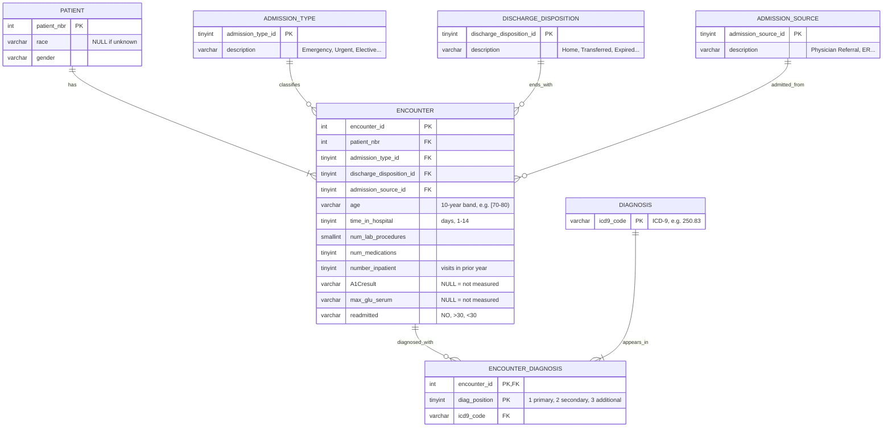

# Hospital Readmissions Database

Relational database design for **101,766 diabetic inpatient encounters** across 130 U.S. hospitals (1999–2008), the [Diabetes 130-US Hospitals](https://www.kaggle.com/datasets/brandao/diabetes) dataset (Strack et al., 2014).

CSCI 49376 Big Data Technology, Hunter College, Assignment 1. This repo holds **Partner A's work: deliverables 1–10** (dataset, attributes, normalization, functional dependencies, keys, ER diagram, relational schema). The SQL scripts and screenshots (deliverables 11–13) are Partner B's and are not included here.

## Report

[CSCI 49376 Assignment 1 Report](https://docs.google.com/document/d/1-cNh-NuGfREmi5sbFYx5jiEWIVyzA_Bz6OedEvMbPFE/edit).


## Part 2. Normalization

Original relation → 1NF → 2NF. Each column below answers the six questions the assignment asks for each stage.

| | Original relation | 1NF | 2NF (final design) |
|---|---|---|---|
| **1. Structure** | `DIABETIC_DATA(encounter_id, patient_nbr, race, gender, age, …, diag_1, diag_2, diag_3, …, readmitted)`: one table, 26 columns, one row per stay | `ENCOUNTER_1NF(encounter_id, diag_position, icd9_code, patient_nbr, race, gender, age, …, readmitted)`: one table, one row per diagnosis | 7 tables (see the table below) |
| **2. Keys** | `encounter_id` | (`encounter_id`, `diag_position`) | One per table (see the table below) |
| **3. Functional dependencies** | `encounter_id` → every other column<br>`patient_nbr` → race, gender<br>each code → its description | **FD1** (`encounter_id`, `diag_position`) → `icd9_code`<br>**FD2** `encounter_id` → age, time_in_hospital, …, readmitted<br>**FD3** `patient_nbr` → race, gender<br>**FD4** code → description | FD1 → ENCOUNTER_DIAGNOSIS<br>FD2 → ENCOUNTER<br>FD3 → PATIENT<br>FD4 → the three code tables |
| **4. Problems** | `diag_1`–`diag_3` are a **repeating group** (three columns for one kind of value). Patient data repeats on every stay: 30,248 extra copies. | **Partial dependency** (FD2): stay columns depend on only part of the key, so each stay's details are copied once per diagnosis. | None. No partial dependencies, and each fact is stored once. |
| **5. Change to reach the next form** | Turn the three diagnosis columns into one row per diagnosis and add `diag_position` (1, 2, 3). | Move FD2's columns to ENCOUNTER, keyed by `encounter_id` alone. To minimize redundancy, also move FD3 to PATIENT and FD4 to code tables. | Final design; no further change needed. |
| **6. Why it satisfies the form** | Not in 1NF (repeating group). | Every cell holds one value, and the repeating group is gone. | Every non-key column depends on the whole key: tables with a one-column key can't have partial dependencies, and in ENCOUNTER_DIAGNOSIS `icd9_code` needs both key columns. |

The key uses `diag_position`, not `icd9_code`, because 5,492 stays list the same code twice.

### Final tables

| Table | Attributes | Primary key | Foreign key(s) |
|---|---|---|---|
| PATIENT | patient_nbr, race, gender | patient_nbr | — |
| ENCOUNTER | encounter_id, patient_nbr, admission_type_id, discharge_disposition_id, admission_source_id, age, weight, time_in_hospital, payer_code, medical_specialty, num_lab_procedures, num_procedures, num_medications, number_outpatient, number_emergency, number_inpatient, number_diagnoses, max_glu_serum, A1Cresult, diabetesMed, readmitted | encounter_id | patient_nbr → PATIENT<br>admission_type_id → ADMISSION_TYPE<br>discharge_disposition_id → DISCHARGE_DISPOSITION<br>admission_source_id → ADMISSION_SOURCE |
| ENCOUNTER_DIAGNOSIS | encounter_id, diag_position, icd9_code | (encounter_id, diag_position) | encounter_id → ENCOUNTER<br>icd9_code → DIAGNOSIS |
| DIAGNOSIS | icd9_code | icd9_code | — |
| ADMISSION_TYPE | admission_type_id, description | admission_type_id | — |
| DISCHARGE_DISPOSITION | discharge_disposition_id, description | discharge_disposition_id | — |
| ADMISSION_SOURCE | admission_source_id, description | admission_source_id | — |

Nothing is lost: joining the tables rebuilds every original row. Expected rows after import: ENCOUNTER 101,766 · PATIENT 71,518 · ENCOUNTER_DIAGNOSIS 303,496 · DIAGNOSIS 915 · code tables 8 / 26 / 17.

## Part 3. ER diagram

### Entities

| Entity | Important attributes | Primary key | Foreign keys |
|---|---|---|---|
| PATIENT | race, gender | patient_nbr | — |
| ENCOUNTER | age, time_in_hospital, A1Cresult, readmitted | encounter_id | patient_nbr, admission_type_id, discharge_disposition_id, admission_source_id |
| DIAGNOSIS | — | icd9_code | — |
| ADMISSION_TYPE | description | admission_type_id | — |
| DISCHARGE_DISPOSITION | description | discharge_disposition_id | — |
| ADMISSION_SOURCE | description | admission_source_id | — |

### Relationships

| Relationship | Between | Type | Why | Participation |
|---|---|---|---|---|
| has | PATIENT – ENCOUNTER | **1:N** | A patient has many stays; a stay has one patient. | Total on both sides |
| classifies | ADMISSION_TYPE – ENCOUNTER | **1:N** | A type covers many stays; a stay has one type. | Total for ENCOUNTER, partial for the type |
| ends_with | DISCHARGE_DISPOSITION – ENCOUNTER | **1:N** | Same pattern. | Total for ENCOUNTER, partial for the disposition |
| admitted_from | ADMISSION_SOURCE – ENCOUNTER | **1:N** | Same pattern. | Total for ENCOUNTER, partial for the source |
| diagnosed_with | ENCOUNTER – DIAGNOSIS | **M:N** | A stay has up to 3 diagnoses; a diagnosis appears in many stays. Attribute: `diag_position`. | Partial for ENCOUNTER (some stays have none), total for DIAGNOSIS |

There are no 1:1 relationships. In the tables, each 1:N becomes a foreign key in ENCOUNTER, and the M:N becomes ENCOUNTER_DIAGNOSIS.

### Diagram

The submitted ER diagram uses Chen notation, as taught in class: `CSCI49376_Assignment1_Yabar/ER_Diagram.pdf`. The same design as tables:



`||--|{` one to one-or-many · `||--o{` one to zero-or-many. Main ENCOUNTER columns only. Source: [`work/table_diagram.mmd`](work/table_diagram.mmd).

## Reproduce the profile

```bash
python3 -m venv .venv && source .venv/bin/activate
pip install -r requirements.txt
kaggle datasets download -d brandao/diabetes -p data --unzip   # needs ~/.kaggle/kaggle.json
python3 work/profile_csv.py data/diabetic_data.csv              # writes work/profile.md
```

The data is not committed. `IDs_mapping.csv` (descriptions for the admission, discharge and source codes) comes from the UCI Machine Learning Repository, dataset 296; put it in `data/` too.
