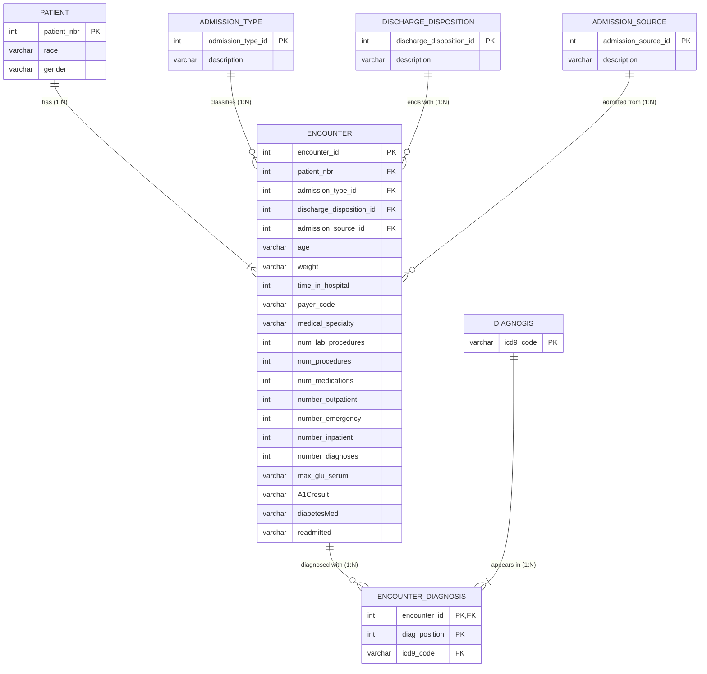

# Hospital Readmissions Database

Relational database design for **101,766 diabetic inpatient encounters** across 130 U.S. hospitals (1999–2008), the [Diabetes 130-US Hospitals](https://www.kaggle.com/datasets/brandao/diabetes) dataset (Strack et al., 2014).

CSCI 49376 Big Data Technology, Hunter College, Assignment 1. This repo holds **Partner A's work: Parts 1–4** of the assignment (dataset analysis, normalization, ER diagram, relational schema). The SQL implementation (Parts 5–7) is Partner B's and is not included here.

## Report

[CSCI 49376 Assignment 1 Report](https://docs.google.com/document/d/1sUI69l851CSfqtwmvFO14M0J4KRrnKSH_ZljGQQWP0k/edit) (Google Doc, the source of truth). The sections below match it. PDF: [`CSCI49376_Assignment1_Yabar/Assignment1_Report.pdf`](CSCI49376_Assignment1_Yabar/Assignment1_Report.pdf).

## Part 1. Select and Examine the Original Dataset

| # | Required | Answer |
|---|---|---|
| 1 | Dataset selected | Option 2: Diabetes 130-US Hospitals for Years 1999–2008 (Kaggle: brandao/diabetes) |
| 2 | CSV file used | `diabetic_data.csv` |
| 3 | Total rows | 101,766 (one row per hospital stay) |
| 4 | Total columns | 50 (24 ignored as instructed, 26 used) |

### 5–6. Attributes and what each represents

| Attribute | Description |
|---|---|
| encounter_id | Unique ID of one hospital stay |
| patient_nbr | ID of a patient (a patient can have several stays) |
| race | Caucasian, AfricanAmerican, Hispanic, Asian, Other |
| gender | Female, Male, Unknown/Invalid |
| age | Age group in 10-year bands, e.g. [70-80) |
| weight | Weight band in pounds |
| admission_type_id | Code: type of admission (e.g. emergency, elective) |
| discharge_disposition_id | Code: where the patient went at discharge (e.g. home) |
| admission_source_id | Code: where the patient came from (e.g. referral, ER) |
| time_in_hospital | Days in the hospital (1–14) |
| payer_code | Insurance code (e.g. MC = Medicare) |
| medical_specialty | Specialty of the admitting doctor |
| num_lab_procedures | Lab tests during the stay |
| num_procedures | Other procedures during the stay |
| num_medications | Distinct medications given |
| number_outpatient | Outpatient visits in the prior year |
| number_emergency | Emergency visits in the prior year |
| number_inpatient | Inpatient visits in the prior year |
| diag_1 | Primary diagnosis (ICD-9 code) |
| diag_2 | Secondary diagnosis (ICD-9 code) |
| diag_3 | Additional diagnosis (ICD-9 code) |
| number_diagnoses | Number of diagnoses recorded |
| max_glu_serum | Glucose test: >200, >300, Norm, None (not measured) |
| A1Cresult | HbA1c test: >7, >8, Norm, None (not measured) |
| diabetesMed | Any diabetes medication prescribed: Yes/No |
| readmitted | NO, >30 (after 30 days), <30 (within 30 days) |
| metformin, repaglinide, nateglinide, chlorpropamide, glimepiride, acetohexamide, glipizide, glyburide, tolbutamide, pioglitazone, rosiglitazone, acarbose, miglitol, troglitazone, tolazamide, examide, citoglipton, insulin, glyburide-metformin, glipizide-metformin, glimepiride-pioglitazone, metformin-rosiglitazone, metformin-pioglitazone, change | Ignored, as instructed: 23 medication columns (No, Steady, Up, Down) and whether any medication changed |

### 7. Possible identifiers or keys

| Column | Finding |
|---|---|
| encounter_id | Unique on all 101,766 rows → primary key of the original table |
| patient_nbr | 71,518 distinct values; repeats across stays → identifies a separate PATIENT entity |
| admission_type_id, discharge_disposition_id, admission_source_id | 8, 26 and 17 codes → reference tables (descriptions in `IDs_mapping.csv`, UCI) |
| diag_1, diag_2, diag_3 | 915 distinct ICD-9 codes → a DIAGNOSIS entity |

### 8. Missing, unknown or incomplete values

| Column | Missing | Written as |
|---|---|---|
| weight | 96.9% | ? |
| max_glu_serum | 94.7% | None (not measured) |
| A1Cresult | 83.3% | None (not measured) |
| medical_specialty | 49.1% | ? |
| payer_code | 39.6% | ? |
| race | 2.2% | ? |
| diag_3 / diag_2 / diag_1 | 1.4% / 0.4% / 21 rows | ? |
| gender | 3 rows | Unknown/Invalid |

All are stored as NULL. Inconsistencies: 123 patients have two different race values and 3 have two genders across stays (we keep the value from the patient's latest stay); age changes between stays for 1,574 patients, so age belongs to the stay.

## Part 2. Normalize the Dataset

### Original relation

1. **Structure:** DIABETIC_DATA(encounter_id, patient_nbr, race, gender, age, …, diag_1, diag_2, diag_3, …, readmitted), one row per stay
2. **Key:** encounter_id
3. **FDs:** encounter_id → all columns · patient_nbr → race, gender
4. **Problem:** diag_1–diag_3 are a repeating group
5. **Change:** one row per diagnosis, with diag_position (1, 2, 3)
6. **Form:** not 1NF (repeating group)

### 1NF relation

1. **Structure:** ENCOUNTER_1NF(encounter_id, diag_position, icd9_code, patient_nbr, race, gender, age, …, readmitted), one row per diagnosis
2. **Key:** (encounter_id, diag_position). The code alone can't be the key, because 5,492 stays repeat a code.
3. **FDs:** (encounter_id, diag_position) → icd9_code · encounter_id → all stay columns · patient_nbr → race, gender
4. **Problem:** partial dependency: stay columns depend on encounter_id only, so they repeat per diagnosis
5. **Change:** move the stay columns to ENCOUNTER, the patient columns to PATIENT, and the codes to their own tables
6. **Form:** 1NF (every cell holds one value)

| encounter_id | diag_position | icd9_code | time_in_hospital |
|---|---|---|---|
| 1001 | 1 | 250.01 | 3 |
| 1001 | 2 | 401 | 3 |
| 1001 | 3 | 428 | 3 |

### 2NF relations

1. **Structure:** the 7 tables below
2. **Keys:** see the Primary key column
3. **FDs:** each table's columns depend on its whole key
4. **Problem:** none; each fact is stored once
5. **Change:** none (final design)
6. **Form:** 2NF (no partial dependencies)

### Final tables

| Table | Attributes | Primary key | Foreign key(s) |
|---|---|---|---|
| PATIENT | patient_nbr, race, gender | patient_nbr | — |
| ENCOUNTER | encounter_id, patient_nbr, admission_type_id, discharge_disposition_id, admission_source_id, age, weight, time_in_hospital, payer_code, medical_specialty, num_lab_procedures, num_procedures, num_medications, number_outpatient, number_emergency, number_inpatient, number_diagnoses, max_glu_serum, A1Cresult, diabetesMed, readmitted | encounter_id | patient_nbr → PATIENT<br>admission_type_id → ADMISSION_TYPE<br>discharge_disposition_id → DISCHARGE_DISPOSITION<br>admission_source_id → ADMISSION_SOURCE |
| ENCOUNTER_DIAGNOSIS | encounter_id, diag_position, icd9_code | (encounter_id, diag_position) | encounter_id → ENCOUNTER<br>icd9_code → DIAGNOSIS |
| DIAGNOSIS | icd9_code | icd9_code | — |
| ADMISSION_TYPE | admission_type_id, description | admission_type_id | — |
| DISCHARGE_DISPOSITION | discharge_disposition_id, description | discharge_disposition_id | — |
| ADMISSION_SOURCE | admission_source_id, description | admission_source_id | — |

Lossless: joining the tables rebuilds every original row. Expected rows: ENCOUNTER 101,766 · PATIENT 71,518 · ENCOUNTER_DIAGNOSIS 303,496 · DIAGNOSIS 915 · code tables 8 / 26 / 17.

## Part 3. Construct an ER Diagram



Source: [`work/er_diagram.mmd`](work/er_diagram.mmd) · PDF: [`CSCI49376_Assignment1_Yabar/ER_Diagram.pdf`](CSCI49376_Assignment1_Yabar/ER_Diagram.pdf)

**Notation (crow's foot):** two bars = exactly one · bar + crow's foot = one or many (total participation) · circle + crow's foot = zero or many (partial participation). PK = primary key, FK = foreign key.

### Relationships, cardinalities and participation

| Relationship | Between | Type | Why | Participation |
|---|---|---|---|---|
| has | PATIENT – ENCOUNTER | 1:N | A patient has many stays; a stay has one patient. | Total on both sides |
| classifies | ADMISSION_TYPE – ENCOUNTER | 1:N | A type covers many stays; a stay has one type. | Total for ENCOUNTER, partial for the type |
| ends with | DISCHARGE_DISPOSITION – ENCOUNTER | 1:N | Same pattern. | Total for ENCOUNTER, partial for the disposition |
| admitted from | ADMISSION_SOURCE – ENCOUNTER | 1:N | Same pattern. | Total for ENCOUNTER, partial for the source |
| diagnosed with | ENCOUNTER – DIAGNOSIS | M:N | A stay has up to 3 diagnoses; a diagnosis appears in many stays. Drawn as two 1:N relationships through ENCOUNTER_DIAGNOSIS, which also stores diag_position. | Partial for ENCOUNTER (some stays have no diagnosis), total for DIAGNOSIS |

There are no 1:1 relationships. The diagram matches Part 2: same seven tables, keys and foreign keys.

## Part 4. Convert the ER Diagram into Relational Tables

| Relation | Attributes | Primary key | Foreign key(s) |
|---|---|---|---|
| PATIENT | patient_nbr, race, gender | patient_nbr | — |
| ADMISSION_TYPE | admission_type_id, description | admission_type_id | — |
| DISCHARGE_DISPOSITION | discharge_disposition_id, description | discharge_disposition_id | — |
| ADMISSION_SOURCE | admission_source_id, description | admission_source_id | — |
| DIAGNOSIS | icd9_code | icd9_code | — |
| ENCOUNTER | encounter_id, patient_nbr, admission_type_id, discharge_disposition_id, admission_source_id, age, weight, time_in_hospital, payer_code, medical_specialty, num_lab_procedures, num_procedures, num_medications, number_outpatient, number_emergency, number_inpatient, number_diagnoses, max_glu_serum, A1Cresult, diabetesMed, readmitted | encounter_id | patient_nbr, admission_type_id, discharge_disposition_id, admission_source_id |
| ENCOUNTER_DIAGNOSIS | encounter_id, diag_position, icd9_code | (encounter_id, diag_position) | encounter_id, icd9_code |

### How the ER relationships are represented

| ER relationship | Type | Represented as |
|---|---|---|
| PATIENT has ENCOUNTER | 1:N | Foreign key ENCOUNTER.patient_nbr → PATIENT (on the N side, NOT NULL) |
| ADMISSION_TYPE classifies ENCOUNTER | 1:N | Foreign key ENCOUNTER.admission_type_id → ADMISSION_TYPE |
| DISCHARGE_DISPOSITION ends with ENCOUNTER | 1:N | Foreign key ENCOUNTER.discharge_disposition_id → DISCHARGE_DISPOSITION |
| ADMISSION_SOURCE admitted from ENCOUNTER | 1:N | Foreign key ENCOUNTER.admission_source_id → ADMISSION_SOURCE |
| ENCOUNTER diagnosed with DIAGNOSIS | M:N | Its own table, ENCOUNTER_DIAGNOSIS: a foreign key to each side plus diag_position |

Table creation order: PATIENT, ADMISSION_TYPE, DISCHARGE_DISPOSITION, ADMISSION_SOURCE, DIAGNOSIS → ENCOUNTER → ENCOUNTER_DIAGNOSIS.

## Reproduce the profile

```bash
python3 -m venv .venv && source .venv/bin/activate
pip install -r requirements.txt
kaggle datasets download -d brandao/diabetes -p data --unzip   # needs ~/.kaggle/kaggle.json
python3 work/profile_csv.py data/diabetic_data.csv              # writes work/profile.md
```

The data is not committed. `IDs_mapping.csv` (descriptions for the admission, discharge and source codes) comes from the UCI Machine Learning Repository, dataset 296; put it in `data/` too.
