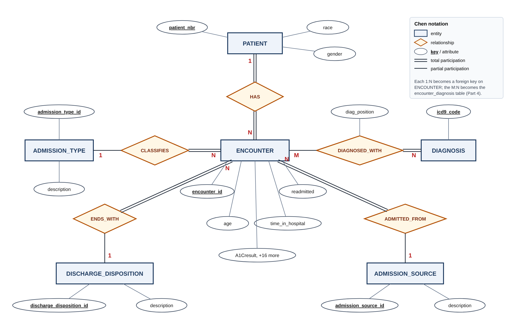

# Hospital Readmissions Database

Relational database design for **101,766 diabetic inpatient encounters** across 130 U.S. hospitals (1999–2008), the [Diabetes 130-US Hospitals](https://www.kaggle.com/datasets/brandao/diabetes) dataset (Strack et al., 2014).

CSCI 49376 Big Data Technology, Hunter College, Assignment 1. This repo holds **Partner A's work: Parts 1–4** (dataset analysis, normalization, ER diagram, relational schema). The SQL implementation (Parts 5–7) is Partner B's and is not included here.

## Repository layout

```
CSCI49376_Assignment1_Yabar/      submission files (Partner A)
    Assignment1_Report.pdf        Parts 1–4
    ER_Diagram.pdf
instructions/                     assignment, presentation instructions, work proposal
work/                             supporting work
    Assignment1_Report.docx       editable source of the report (export to PDF when done)
    profile_csv.py                profiles the raw CSV → profile.md
    profile.md                    rows, columns, missing values, candidate keys
    design.md                     normalization notes and ER diagram source
    er_diagram.png / .svg
data/                             not committed; see data/README.md
```

## Design summary



The flat 50-column CSV (26 columns in scope) is normalized into 7 tables:

| Table | Rows | Primary key |
|---|---|---|
| `encounter` | 101,766 | `encounter_id` |
| `patient` | 71,518 | `patient_nbr` |
| `encounter_diagnosis` | 303,496 | (`encounter_id`, `diag_position`) |
| `diagnosis` | 915 | `icd9_code` |
| `admission_type` / `discharge_disposition` / `admission_source` | 8 / 26 / 17 | `*_id` |

- **1NF:** the repeating `diag_1`–`diag_3` columns become one row per diagnosis, keyed by (`encounter_id`, `diag_position`).
- **2NF:** attributes that depend only on `encounter_id` (a partial dependency) move to `encounter`.
- **Beyond 2NF:** patient demographics and code descriptions get their own tables, removing 30,000+ redundant copies of patient data.

Data quality findings from profiling: `weight` is missing for 96.9% of encounters, HbA1c was measured in only 16.7%, 123 patients have conflicting race values across visits, and 5,690 encounters repeat a diagnosis code in two slots.

## Reproduce the profile

```bash
python3 -m venv .venv && source .venv/bin/activate
pip install -r requirements.txt
kaggle datasets download -d brandao/diabetes -p data --unzip   # needs ~/.kaggle/kaggle.json
python3 work/profile_csv.py data/diabetic_data.csv              # writes work/profile.md
```
