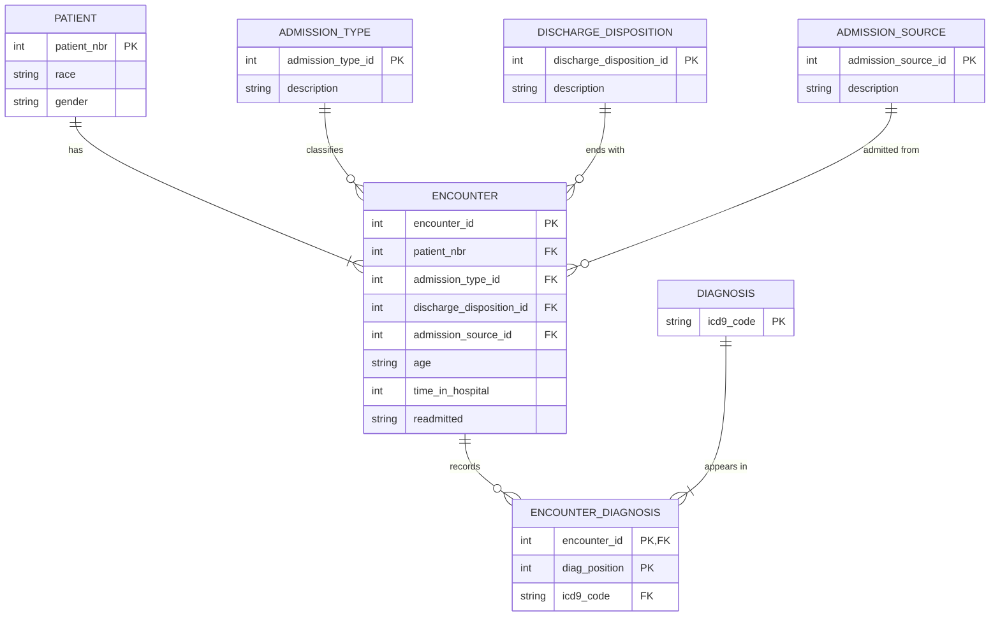

# Assignment 1 design draft: Parts 1–3

Draft for Mia to review and own. Every number below was computed from `data/diabetic_data.csv` (see `profile.md`). Items marked **DECIDE** are design calls you should make and be ready to defend on Monday.

## Part 1. The original dataset

1. **Dataset:** Diabetes 130-US Hospitals for Years 1999–2008 (Kaggle, `brandao/diabetes`; originally Strack et al., 2014, in `data/description.pdf`).
2. **CSV file:** `diabetic_data.csv`
3. **Rows:** 101,766 (one row per hospital encounter)
4. **Columns:** 50. The assignment says to ignore 24 of them (23 medication columns plus `change`), leaving **26** attributes in scope.
5–6. **All 50 attributes.** The 26 in scope:

| Attribute | Meaning |
|---|---|
| `encounter_id` | Unique ID of one hospital stay |
| `patient_nbr` | ID of the patient (a patient can have several encounters) |
| `race` | Caucasian, AfricanAmerican, Hispanic, Asian, Other |
| `gender` | Female, Male, Unknown/Invalid |
| `age` | Age group at the encounter, in 10-year bands: [0-10) … [90-100) |
| `weight` | Weight band in pounds |
| `admission_type_id` | Code for admission type (e.g. emergency, urgent, elective) |
| `discharge_disposition_id` | Code for where the patient went after discharge (e.g. home, expired) |
| `admission_source_id` | Code for where the patient came from (e.g. physician referral, ER) |
| `time_in_hospital` | Days between admission and discharge (1–14) |
| `payer_code` | Insurance/payer code (e.g. MC = Medicare) |
| `medical_specialty` | Specialty of the admitting physician |
| `num_lab_procedures` | Lab tests performed during the encounter |
| `num_procedures` | Non-lab procedures performed |
| `num_medications` | Distinct medications given |
| `number_outpatient` | Outpatient visits in the year before |
| `number_emergency` | Emergency visits in the year before |
| `number_inpatient` | Inpatient visits in the year before |
| `diag_1`, `diag_2`, `diag_3` | Primary, secondary and additional diagnosis (ICD-9 codes) |
| `number_diagnoses` | Number of diagnoses entered for the encounter |
| `max_glu_serum` | Glucose serum test result (>200, >300, Norm, None = not tested) |
| `A1Cresult` | HbA1c test result (>7, >8, Norm, None = not tested) |
| `diabetesMed` | Any diabetes medication prescribed (Yes/No) |
| `readmitted` | NO, >30 (readmitted after 30 days), <30 (within 30 days) |

**The 24 ignored attributes** (still part of the original CSV, so they're listed for item 5):

| Attribute(s) | Meaning |
|---|---|
| `metformin`, `repaglinide`, `nateglinide`, `chlorpropamide`, `glimepiride`, `acetohexamide`, `glipizide`, `glyburide`, `tolbutamide`, `pioglitazone`, `rosiglitazone`, `acarbose`, `miglitol`, `troglitazone`, `tolazamide`, `examide`, `citoglipton`, `insulin`, `glyburide-metformin`, `glipizide-metformin`, `glimepiride-pioglitazone`, `metformin-rosiglitazone`, `metformin-pioglitazone` | One column per diabetes medication (23). Values: `No` (not prescribed), `Steady` (dose unchanged), `Up` (dose increased), `Down` (dose decreased). |
| `change` | Whether any diabetes medication was changed during the encounter: `Ch` (changed) or `No`. |

7. **Identifiers and keys:**
   - `encounter_id` is unique on all 101,766 rows → primary key of an encounter.
   - `patient_nbr` has 71,518 distinct values; 16,773 patients have more than one encounter → identifies a separate Patient entity.
   - `admission_type_id` (8 values), `discharge_disposition_id` (26), `admission_source_id` (17) are codes into lookup lists → foreign keys to small reference tables.
   - `diag_1`–`diag_3` hold 915 distinct ICD-9 codes → a Diagnosis entity.

8. **Missing / unknown values:**

| Attribute | Missing | Written as |
|---|---|---|
| `weight` | 98,569 (96.9%) | `?` |
| `max_glu_serum` | 96,420 (94.7%) | `None` (test not done) |
| `A1Cresult` | 84,748 (83.3%) | `None` (test not done) |
| `medical_specialty` | 49,949 (49.1%) | `?` |
| `payer_code` | 40,256 (39.6%) | `?` |
| `race` | 2,273 (2.2%) | `?` |
| `diag_3` / `diag_2` / `diag_1` | 1,423 / 358 / 21 | `?` |
| `gender` | 3 | `Unknown/Invalid` |

All of these load as SQL `NULL`. For the two lab results, `None` means "not measured", which is information, so **DECIDE**: store as NULL, or keep `'None'` as a value.

**Data-quality findings** (good to mention in the presentation):
- Race is not perfectly consistent per patient: **123 patients** have two different real race values across encounters. **3 patients** have two genders.
- Age changes for **1,574 patients** between visits (they had a birthday), so age belongs to the encounter, not the patient.
- In **5,690 encounters** the same ICD-9 code appears in two diagnosis slots, so the diagnosis code alone can't be part of a key; the slot position must be.

## Part 2. Normalization

### Original relation

`DIABETIC_DATA(encounter_id, patient_nbr, race, gender, age, weight, admission_type_id, discharge_disposition_id, admission_source_id, time_in_hospital, payer_code, medical_specialty, num_lab_procedures, num_procedures, num_medications, number_outpatient, number_emergency, number_inpatient, diag_1, diag_2, diag_3, number_diagnoses, max_glu_serum, A1Cresult, diabetesMed, readmitted)`

- Key: `encounter_id`
- Problems: `diag_1`, `diag_2`, `diag_3` are a **repeating group** (three columns holding the same kind of value). Patient attributes repeat on every encounter: 101,766 − 71,518 = **30,248 redundant copies** of each patient's race and gender. Lookup codes have no descriptions, so the meaning lives outside the table.

### First normal form (1NF)

Rule: every attribute holds one atomic value, and there are no repeating groups.

Change: replace the three diagnosis columns with one row per diagnosis slot.

`ENCOUNTER_1NF(encounter_id, diag_position, icd9_code, patient_nbr, race, gender, age, weight, admission_type_id, …, readmitted)`

- Key: **(`encounter_id`, `diag_position`)**, where `diag_position` is 1, 2 or 3. Position, not code, because 5,690 encounters repeat a code.
- Functional dependencies:
  - FD1: `encounter_id, diag_position → icd9_code` (full key)
  - FD2: `encounter_id → patient_nbr, age, weight, admission_type_id, discharge_disposition_id, admission_source_id, time_in_hospital, payer_code, medical_specialty, num_lab_procedures, num_procedures, num_medications, number_outpatient, number_emergency, number_inpatient, number_diagnoses, max_glu_serum, A1Cresult, diabetesMed, readmitted` (**part of the key**)
  - FD3: `patient_nbr → race, gender` (holds for all but 123 / 3 patients, see Part 1)
  - FD4: `admission_type_id → admission_type_description` (and the same for discharge disposition and admission source)
- Why it's 1NF: every cell is atomic and the repeating group is gone.
- Remaining problem: FD2 is a **partial dependency**. Every encounter attribute is now copied up to three times, once per diagnosis row. That is what 2NF fixes.

### Second normal form (2NF)

Rule: 1NF, and every non-key attribute depends on the **whole** primary key, not part of it.

Change: move everything that depends only on `encounter_id` into its own table.

- `ENCOUNTER(encounter_id, patient_nbr, race, gender, age, …, readmitted)` — key `encounter_id`
- `ENCOUNTER_DIAGNOSIS(encounter_id, diag_position, icd9_code)` — key (`encounter_id`, `diag_position`); FK `encounter_id`

Why it's 2NF: `ENCOUNTER` has a single-column key, so a partial dependency is impossible. In `ENCOUNTER_DIAGNOSIS` the only non-key attribute, `icd9_code`, needs both key parts.

### Going past 2NF to remove remaining redundancy

The assignment requires 2NF and says to minimize redundancy. Two dependencies still cause repetition: FD3 (`patient_nbr → race, gender`) and FD4 (code → description). These are **transitive** dependencies (encounter → patient → race), which is what 3NF removes. Splitting them out:

- `PATIENT(patient_nbr, race, gender)`
- `ADMISSION_TYPE(admission_type_id, description)`, `DISCHARGE_DISPOSITION(discharge_disposition_id, description)`, `ADMISSION_SOURCE(admission_source_id, description)`
- `DIAGNOSIS(icd9_code)` so that `ENCOUNTER_DIAGNOSIS.icd9_code` can be a foreign key

**DECIDE:** for the 123 patients with conflicting race, keep the most frequent non-missing value (or the one on their latest encounter). Say which rule you used.

**DECIDE:** the descriptions for the three code tables come from `IDs_mapping.csv`, which is in the UCI version of this dataset (archive.ics.uci.edu, dataset 296) but not the Kaggle download. Download it in your browser into `data/`. Without it, those tables hold only IDs.

### Final tables

| Table | Attributes | Primary key | Foreign keys |
|---|---|---|---|
| `patient` | patient_nbr, race, gender | patient_nbr | — |
| `admission_type` | admission_type_id, description | admission_type_id | — |
| `discharge_disposition` | discharge_disposition_id, description | discharge_disposition_id | — |
| `admission_source` | admission_source_id, description | admission_source_id | — |
| `diagnosis` | icd9_code | icd9_code | — |
| `encounter` | encounter_id, patient_nbr, age, weight, admission_type_id, discharge_disposition_id, admission_source_id, time_in_hospital, payer_code, medical_specialty, num_lab_procedures, num_procedures, num_medications, number_outpatient, number_emergency, number_inpatient, number_diagnoses, max_glu_serum, A1Cresult, diabetesMed, readmitted | encounter_id | patient_nbr → patient; admission_type_id → admission_type; discharge_disposition_id → discharge_disposition; admission_source_id → admission_source |
| `encounter_diagnosis` | encounter_id, diag_position, icd9_code | (encounter_id, diag_position) | encounter_id → encounter; icd9_code → diagnosis |

Expected row counts for Partner B's verification: `encounter` 101,766 · `patient` 71,518 · `diagnosis` 915 · `admission_type` 8 · `discharge_disposition` 26 · `admission_source` 17 · `encounter_diagnosis` 303,496 (305,298 slots minus 1,802 `?` slots).

## Part 3. ER diagram

Obsidian renders this. Export the note to PDF for `ER_Diagram.pdf`, or redraw it in draw.io / Lucidchart if you want participation shown with double lines.

Relationships, cardinality and participation:

| Relationship | Cardinality | Participation |
|---|---|---|
| Patient has Encounter | 1:N | Every encounter has exactly one patient (total). Every patient in the data has at least one encounter (total). |
| Admission type / discharge disposition / admission source → Encounter | 1:N each | Every encounter has one of each (total). A code may be unused (partial). |
| Encounter — Diagnosis (through `encounter_diagnosis`) | **M:N** | An encounter has 0–3 diagnoses (partial: 21 encounters have no primary diagnosis). Each diagnosis code appears in at least one encounter (total). |

The M:N between encounter and diagnosis is why `encounter_diagnosis` exists: an M:N relationship becomes its own table with a foreign key to each side.

## Part 4. Relational schema (converted from the ER diagram)

Notation: **bold** = primary key, *italic* = foreign key.

- `patient`(**patient_nbr**, race, gender)
- `admission_type`(**admission_type_id**, description)
- `discharge_disposition`(**discharge_disposition_id**, description)
- `admission_source`(**admission_source_id**, description)
- `diagnosis`(**icd9_code**)
- `encounter`(**encounter_id**, *patient_nbr*, *admission_type_id*, *discharge_disposition_id*, *admission_source_id*, age, weight, time_in_hospital, payer_code, medical_specialty, num_lab_procedures, num_procedures, num_medications, number_outpatient, number_emergency, number_inpatient, number_diagnoses, max_glu_serum, A1Cresult, diabetesMed, readmitted)
- `encounter_diagnosis`(***encounter_id***, **diag_position**, *icd9_code*)

**How each ER relationship becomes tables and keys:**

| ER relationship | Type | How it's represented |
|---|---|---|
| Patient has Encounter | 1:N | FK `encounter.patient_nbr` → `patient.patient_nbr`. The FK goes on the "many" side. `NOT NULL`, because every encounter has a patient (total participation). |
| Admission type classifies Encounter | 1:N | FK `encounter.admission_type_id` → `admission_type`, `NOT NULL` |
| Discharge disposition ends Encounter | 1:N | FK `encounter.discharge_disposition_id` → `discharge_disposition`, `NOT NULL` |
| Admission source admits Encounter | 1:N | FK `encounter.admission_source_id` → `admission_source`, `NOT NULL` |
| Encounter has Diagnosis | M:N | A separate table, `encounter_diagnosis`, with an FK to each side: `encounter_id` → `encounter` and `icd9_code` → `diagnosis`. Its PK is (`encounter_id`, `diag_position`), which also keeps the primary / secondary / additional order. `diag_position` is limited to 1, 2 or 3. |

**For Partner B's `create_tables.sql`:** create the five parent tables first (`patient`, the three code tables, `diagnosis`), then `encounter`, then `encounter_diagnosis`. Otherwise the foreign keys have nothing to point at.

The schema matches the ER diagram one-to-one: seven entities, seven tables, and every relationship line is exactly one foreign key (or, for the M:N, the junction table).

## After submitting: SQL and Power BI analysis (portfolio layer)

Not part of the assignment. This turns the database into the resume project.

**SQL questions** (each one query against the normalized tables):
1. 30-day readmission rate overall and by age group (`readmitted = '<30'`, joined to nothing, grouped by `age`)
2. Readmission rate by admission type (join `admission_type`)
3. Average `time_in_hospital` by discharge disposition
4. Readmission rate when HbA1c was tested vs. not (`A1Cresult` NULL or not), the question the original paper asked
5. Top 10 primary diagnoses (`diag_position = 1`) by encounter count and by readmission rate
6. Patients with 3+ encounters and their readmission pattern (window function: `ROW_NUMBER() OVER (PARTITION BY patient_nbr ORDER BY encounter_id)`)

**Power BI dashboard** (connect Power BI to the MySQL database, or to CSV exports of the query results):
- KPI cards: encounters, patients, 30-day readmission rate, average length of stay
- Bar chart: readmission rate by age group
- Bar chart: readmission rate by admission type
- Matrix: HbA1c tested × readmitted
- Slicers: gender, race, admission source

That's the analyst version of the project: *"Designed a normalized relational database for 100K+ hospital encounters; wrote SQL analyses of 30-day readmission drivers and built a Power BI dashboard to present them."*
